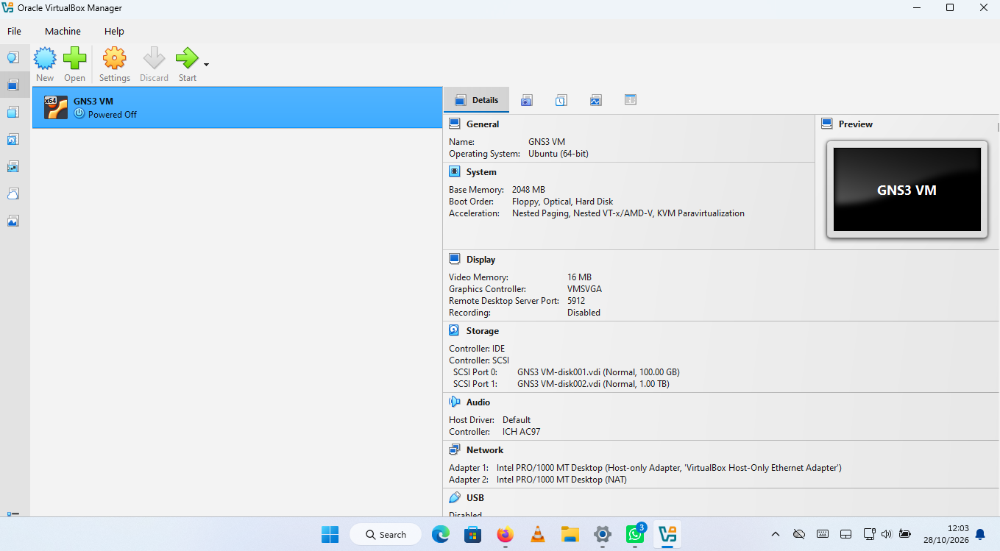
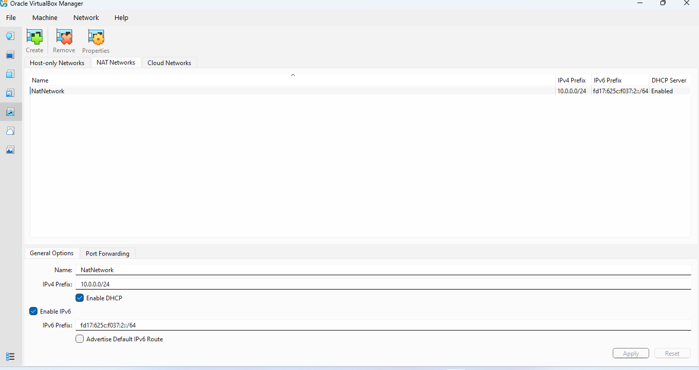

# NETWORKWALKSNDIMANYA-B083-WK1-PM1-CYBERSECURITY-LAB-SETUP

## Introduction
This project involved installing Kali Linux on Oracle VirtualBox and configuring its network settings to establish internet connectivity. The practical work was completed using a Windows host operating system.

## Step 1: Downloading and Installing 7-Zip

I downloaded 7-Zip from its official website and installed it on my Windows computer. 7-Zip was used to extract the downloaded Kali Linux virtual machine files

## Step 2: Downloading and Installing Oracle VirtualBox

I downloaded and installed Oracle VirtualBox. VirtualBox provides a virtual environment that allows Kali Linux to run on my Windows computer without replacing the host operating system.


## Step 3: Creating a NAT Network

I created a NAT Network in VirtualBox to allow the Kali Linux virtual machine to communicate with external networks and access the internet.

The network was configured with the following settings:

- Network Name: Kali-Network
- Network CIDR: `10.0.0.0/24`
- Gateway: `10.0.0.1`
  


## Step 4: Downloading and Importing Kali Linux

I downloaded the Kali Linux VirtualBox virtual machine image. After downloading, I extracted the files using 7-Zip and opened the `.vbox` virtual machine configuration file in VirtualBox.

This successfully added Kali Linux to VirtualBox.


## Step 5: Configuring the Virtual Machine Network Adapter

I configured the Kali Linux virtual machine network adapter to use the NAT Network created in Step 3.

This allowed the virtual machine to connect through the configured virtual network.

## Step 6: Configuring a Static IP Address in Kali Linux

I configured the Kali Linux network interface (`eth0`) with a static IPv4 address using NetworkManager.

The following network parameters were configured:

| Parameter | Value |
|---|---|
| IPv4 Method | Manual |
| IP Address | `10.0.0.2` |
| Subnet Mask | `255.255.255.0` |
| Default Gateway | `10.0.0.1` |
| Primary DNS | `8.8.8.8` |
| Secondary DNS | `1.1.1.1` |

The configuration was applied using the following commands:

```bash
sudo nmcli connection modify "Wired connection 1" ipv4.method manual ipv4.addresses 10.0.0.2/24 ipv4.gateway 10.0.0.1 ipv4.dns "8.8.8.8 1.1.1.1"

sudo nmcli connection up "Wired connection 1"
```

## Step 7: Verifying Network Configuration

I used Linux networking commands to inspect the assigned IP address and routing table.

Commands used:

```bash
ip -4 addr show eth0
ip route
```


## Step 8: Testing Network Connectivity

I performed connectivity tests using the `ping` command to check communication with the default gateway, an external IP address, and a domain name.

Commands used:

```bash
ping -c 4 10.0.0.1
ping -c 4 8.8.8.8
ping -c 4 google.com
```


## Conclusion

This practical exercise provided hands-on experience in installing Kali Linux using Oracle VirtualBox, creating a NAT Network, configuring a static IP address, and performing basic network troubleshooting and connectivity tests.
